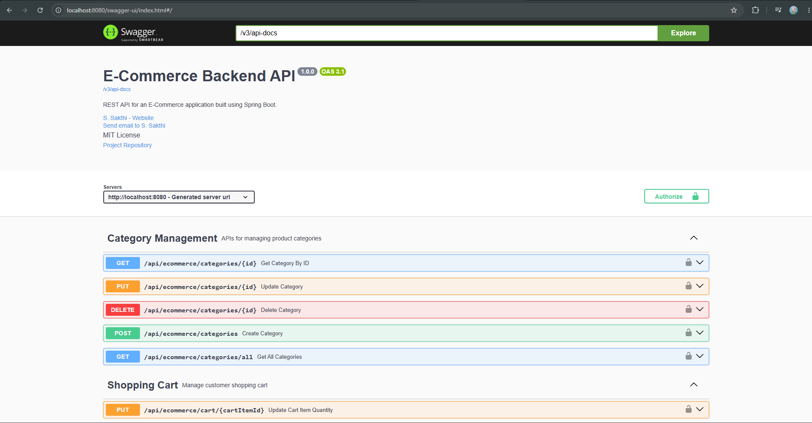

# E-Commerce Backend System


A modular, production-style **E-Commerce REST API** built with **Spring Boot**, featuring JWT-based authentication, role-based access control, product & category management, a shopping cart, and a full order/checkout workflow.

---

## Project Overview

This project is a backend system for an online store, exposing REST APIs that power the core flows of an e-commerce platform: user registration/login, product catalog browsing (with search & pagination), category management, cart operations, and order checkout with status tracking. Access is secured with JWT and enforced via role-based authorization (`ADMIN` / `CUSTOMER`).

---

## Key Highlights

- Feature-based modular architecture
- JWT Authentication & Role-Based Authorization
- Secure password storage using BCrypt
- Swagger/OpenAPI Documentation
- Pagination & Search APIs
- Global Exception Handling
- Admin & Customer role separation
- Ready for cloud deployment

---

## Features

- **JWT Authentication** — stateless login/register with role-based access control
- **BCrypt Password Hashing** — passwords are never stored in plain text
- **Product Management** (CRUD, Pagination, Search) — create, update, delete, fetch by ID/category, paginate, and search products
- **Category Management** — full CRUD for product categories
- **Shopping Cart** — add, update, remove items, and clear cart per user
- **Order Management** — checkout from cart, view order history & details, cancel orders, track status
- **Order Status Workflow** — `PLACED → CONFIRMED → SHIPPED → OUT_FOR_DELIVERY → DELIVERED` (with `CANCELLED` as a terminal state)
- **Admin Controls** — admin-only endpoints for managing products, categories, and order statuses
- **Auto-Seeded Admin Account** — a default admin user is created on application startup
- **Global Exception Handling** — consistent, structured error responses across all modules
- **Swagger / OpenAPI Docs** — interactive API documentation out of the box

---

## Live Deployment

| Service | URL |
|---------|-----|
| **Backend API** | https://e-commerce-backend-system-wx3q.onrender.com |
| **Swagger UI** | https://e-commerce-backend-system-wx3q.onrender.com/swagger-ui/index.html |
| **OpenAPI Specification** | https://e-commerce-backend-system-wx3q.onrender.com/v3/api-docs |

> **Note:** This project is a backend REST API. There is no frontend interface. Use the Swagger UI above to explore and test the API endpoints.

---

## Tech Stack

| Layer | Technology |
|---|---|
| Language | Java 21+ *(developed using JDK 26)* |
| Framework | Spring Boot 4.1.0 |
| Security | Spring Security + JJWT (JSON Web Tokens) |
| Persistence | Spring Data JPA (Hibernate) |
| Database | MySQL (Development), PostgreSQL (Deployment) |
| Validation | Jakarta Bean Validation (`spring-boot-starter-validation`) |
| API Docs | springdoc-openapi (Swagger UI) |
| Boilerplate Reduction | Lombok |
| Build Tool | Maven |

---

## Architecture

The application follows a **modular, layered architecture**, where each business domain (`user`, `product`, `category`, `cart`, `order`) is organized as a self-contained feature module rather than split across generic `controller/`, `service/`, `repository/` packages.

```
Client
  │
  ▼
Controller Layer   (REST endpoints, request/response DTOs, validation)
  │
  ▼
Service Layer      (business logic, transactions)
  │
  ▼
Repository Layer   (Spring Data JPA repositories)
  │
  ▼
MySQL Database
```

Cross-cutting concerns:
- **Security layer** (`security/`) — JWT filter, token service, and Spring Security configuration intercept every request before it reaches a controller.
- **Global exception handling** (`exceptions/`) — centralizes error-to-HTTP-status mapping for all modules.
- **Config layer** (`config/`) — Swagger/OpenAPI setup and startup admin seeding.

**Patterns & principles used:**

- Modular Layered Architecture
- DTO Pattern
- Repository Pattern
- Dependency Injection
- Global Exception Handling

---

## Project Structure

```
Ecommerce/
└── src/main/java/com/ecommerce/backend/
    │
    ├── EcommerceApplication.java        # Application entry point
    │
    ├── config/
    │   ├── AdminInitializer.java        # Seeds default admin on startup
    │   └── SwaggerConfig.java           # OpenAPI/Swagger configuration
    │
    ├── security/
    │   ├── JwtService.java              # Token generation & validation
    │   ├── JwtAuthenticationFilter.java # Per-request JWT filter
    │   ├── CustomUserDetailsService.java
    │   └── SecurityConfig.java          # Security filter chain & rules
    │
    ├── user_module/
    │   ├── UserController.java          # /api/ecommerce/auth
    │   ├── UserService.java
    │   ├── UserRepository.java
    │   ├── models/ (User, Role)
    │   └── dto/ (RegisterRequest, LoginRequest, LoginResponse, UserResponse)
    │
    ├── product_module/
    │   ├── ProductController.java       # /api/ecommerce/products
    │   ├── ProductService.java
    │   ├── ProductRepository.java
    │   ├── models/Product.java
    │   └── dto/ (ProductRequest, ProductResponse)
    │
    ├── category_module/
    │   ├── CategoryController.java      # /api/ecommerce/categories
    │   ├── CategoryService.java
    │   ├── CategoryRepository.java
    │   ├── models/Category.java
    │   └── dto/ (CategoryRequest, CategoryResponse)
    │
    ├── cart_module/
    │   ├── CartController.java          # /api/ecommerce/cart
    │   ├── CartService.java
    │   ├── CartRepository.java / CartItemRepository.java
    │   ├── models/ (Cart, CartItem)
    │   └── dto/ (CartRequest, CartResponse, CartItemResponse, UpdateCartRequest)
    │
    ├── order_module/
    │   ├── OrderController.java         # /api/ecommerce/orders
    │   ├── OrderService.java
    │   ├── OrderRepository.java / OrderItemRepository.java
    │   ├── models/ (Order, OrderItem, OrderStatus)
    │   └── dto/ (CheckoutResponse, OrderSummaryResponse, OrderDetailsResponse, ...)
    │
    ├── exceptions/
    │   ├── GlobalExceptionHandler.java  # Centralized error handling
    │   └── ... (domain-specific exceptions)
    │
    └── common/
        └── PageResponse.java            # Generic pagination wrapper
```
---

## Database Schema

**Entities & Relationships**

| Entity | Key Fields | Relationships |
|---|---|---|
| **User** | id, firstName, lastName, email (unique), password, role, createdAt | 1:1 → Cart, 1:N → Order |
| **Role** *(enum)* | `ADMIN`, `CUSTOMER` | — |
| **Product** | id, name (unique), description, price, stockQuantity, imageUrl | N:1 → Category, 1:N → CartItem |
| **Category** | id, name (unique) | 1:N → Product |
| **Cart** | id | 1:1 → User, 1:N → CartItem |
| **CartItem** | id, quantity | N:1 → Cart, N:1 → Product |
| **Order** | id, orderDate, totalAmount, status | N:1 → User, 1:N → OrderItem |
| **OrderItem** | id, quantity, price | N:1 → Order, N:1 → Product |
| **OrderStatus** *(enum)* | `PLACED`, `CONFIRMED`, `SHIPPED`, `OUT_FOR_DELIVERY`, `DELIVERED`, `CANCELLED` | — |

**Relationship overview**

```
User (1) ──────── (1) Cart ──────── (N) CartItem ──────── (N) Product
  │                                                              │
  │                                                              │
  └── (N) Order ──── (N) OrderItem ─────────────────────────────┘
                                                                  │
                                                Category (1) ──── (N)
```

> Tables are auto-created/updated by Hibernate (`spring.jpa.hibernate.ddl-auto=update`) — no manual schema setup is required.

---

## API Documentation

Base path: **`/api/ecommerce`**

### Authentication — `/auth`
| Method | Endpoint | Access | Description |
|---|---|---|---|
| POST | `/auth/register` | Public | Register a new customer |
| POST | `/auth/login` | Public | Log in and receive a JWT |

### Products — `/products`
| Method | Endpoint | Access | Description |
|---|---|---|---|
| POST | `/products` | ADMIN | Create a product |
| GET | `/products` | ADMIN, CUSTOMER | Get all products |
| GET | `/products/{id}` | ADMIN, CUSTOMER | Get product by ID |
| PUT | `/products/{id}` | ADMIN | Update a product |
| DELETE | `/products/{id}` | ADMIN | Delete a product |
| GET | `/products/category/{categoryId}` | ADMIN, CUSTOMER | Get products by category |
| GET | `/products/page?page=&size=&sortBy=&direction=` | ADMIN, CUSTOMER | Paginated product listing |
| GET | `/products/search?keyword=` | ADMIN, CUSTOMER | Search products by keyword |

### Categories — `/categories`
| Method | Endpoint | Access | Description |
|---|---|---|---|
| POST | `/categories` | ADMIN | Create a category |
| GET | `/categories/all` | ADMIN, CUSTOMER | Get all categories |
| GET | `/categories/{id}` | ADMIN, CUSTOMER | Get category by ID |
| PUT | `/categories/{id}` | ADMIN | Update a category |
| DELETE | `/categories/{id}` | ADMIN | Delete a category |

### Cart — `/cart`
| Method | Endpoint | Access | Description |
|---|---|---|---|
| POST | `/cart/add` | Authenticated | Add a product to the cart |
| GET | `/cart` | Authenticated | View the current cart |
| PUT | `/cart/{cartItemId}` | Authenticated | Update quantity of a cart item |
| DELETE | `/cart/{cartItemId}` | Authenticated | Remove an item from the cart |
| DELETE | `/cart/clear` | Authenticated | Clear the entire cart |

### Orders — `/orders`
| Method | Endpoint | Access | Description |
|---|---|---|---|
| POST | `/orders/checkout` | Authenticated | Place an order from the current cart |
| GET | `/orders` | Authenticated | View my order history |
| GET | `/orders/{orderId}` | Authenticated (owner) | View order details |
| PUT | `/orders/{orderId}/cancel` | Authenticated (owner) | Cancel an order |
| GET | `/orders/{orderId}/status` | Authenticated (owner) | Track order status |
| PUT | `/orders/{orderId}/status` | ADMIN | Update order status |

> Full request/response schemas, sample payloads, and status codes are available live via **Swagger UI** (see below).

---

## Authentication

- Authentication is **stateless**, using **JWT (JSON Web Tokens)**.
- On successful `/auth/login`, the server returns a signed JWT containing the user's email.
- The client must send this token on every subsequent request as:

```
Authorization: Bearer <your_jwt_token>
```

- A custom `JwtAuthenticationFilter` intercepts each request, validates the token, and loads the authenticated user before it reaches the controller layer.
- **Role-based access control** is enforced with `@PreAuthorize`:
    - `ADMIN` — full access (manage products, categories, order statuses)
    - `CUSTOMER` — shop, manage own cart, and manage own orders
- Public endpoints (no token required): `/api/ecommerce/auth/**` and Swagger UI routes.
- Passwords are hashed using **BCrypt** before being persisted.

---

## Installation & Setup

### Prerequisites
- Java 21+ (JDK) — *developed and tested on JDK 26*
- Maven 3.9+ (or use the included `./mvnw` wrapper)
- MySQL 8+ running locally or remotely

### Steps

1. **Clone the repository**
   ```bash
   git clone https://github.com/Sakthi145/E-Commerce-Backend-System.git
   cd Ecommerce
   ```

2. **Create the database**

   If using MySQL locally:
   ```sql
   CREATE DATABASE ecommerce_db;
   ```

   *(For deployment, this project is configured to run against PostgreSQL instead — see [Environment Variables](#-environment-variables).)*

3. **Configure environment variables** (see [Environment Variables](#-environment-variables) below)

4. **Build the project**
   ```bash
   ./mvnw clean install
   ```

5. **Run the application**
   ```bash
   ./mvnw spring-boot:run
   ```

6. The API will be available at(Local):
   ```
   http://localhost:8080
   ```

7. The API will be available at(Live):
   ```
   https://e-commerce-backend-system-wx3q.onrender.com
   ```

8. A default admin account is auto-created on first startup (see [Default Admin Credentials](#-default-admin-credentials)).

---

## Environment Variables

> The repository does not contain production secrets. Configure the following environment variables before running the application.

```properties
spring.application.name=Ecommerce

# MySQL Database Connection Settings
spring.datasource.url=${DB_URL}
spring.datasource.username=${DB_USERNAME}
spring.datasource.password=${DB_PASSWORD}
spring.datasource.driver-class-name=com.mysql.cj.jdbc.Driver

# Hibernate / JPA Settings
spring.jpa.hibernate.ddl-auto=update
spring.jpa.show-sql=true

# JWT Settings
jwt.secret=${JWT_SECRET}
jwt.expiration=${JWT_EXPIRATION:86400000}
```

| Variable | Description | Example |
|---|---|---|
| `DB_URL` | Full JDBC connection URL | `jdbc:mysql://localhost:3306/ecommerce_db?useSSL=false&serverTimezone=UTC&allowPublicKeyRetrieval=true` |
| `DB_USERNAME` | Database username | `root` |
| `DB_PASSWORD` | Database password | `your_db_password` |
| `JWT_SECRET` | Base64-encoded secret key used to sign JWTs | `<generate a strong random secret>` |
| `JWT_EXPIRATION` | Token validity in milliseconds | `86400000` (24h) |

You can set these via a `.env` file with `spring-dotenv`, your IDE's run configuration, or system environment variables before starting the app.

---

## Default Admin Credentials

On first application startup, an admin account is seeded automatically if it doesn't already exist:

| Field | Value |
|---|---|
| Email | `admin@gmail.com` |
| Password | `Admin@123` |
| Role | `ADMIN` |

> **Security note:** Change this password immediately after your first login in any non-local environment, or override the seeding logic in `AdminInitializer.java` to pull credentials from environment variables instead.

---

## Swagger UI

### Local

```
http://localhost:8080/swagger-ui/index.html
```

### Live

```
https://e-commerce-backend-system-wx3q.onrender.com/swagger-ui/index.html
```

### OpenAPI Specification

```
https://e-commerce-backend-system-wx3q.onrender.com/v3/api-docs
```

Click **Authorize** in Swagger UI and paste your JWT (`Bearer <token>`) to test protected endpoints directly from the browser.

---

## Screenshots

### Swagger UI



---

## Future Improvements

- Payment gateway integration (Razorpay / Stripe)
- Refresh token support for JWT
- Product reviews & ratings module
- Wishlist / favorites feature
- Email notifications for order status updates
- Docker & docker-compose setup for one-command deployment
- Unit & integration test coverage
- Rate limiting on auth endpoints
- Multi-image support for products (currently single `imageUrl`)
- Move all secrets to environment variables / a secrets manager
- Cloud image storage (AWS S3 / Cloudinary)

---

## License

This project is licensed under the **MIT License**.

---

## Author

**S. Sakthi**
📧 [ushasakthi2003@gmail.com](mailto:ushasakthi2003@gmail.com)
🔗 GitHub: [https://github.com/Sakthi145](https://github.com/Sakthi145)

---

<p align="center">If you found this useful, consider giving it a star!</p>